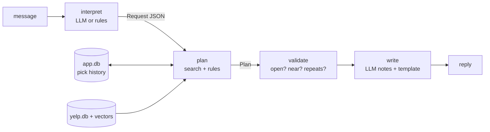

# City Guide (Yelp Open Dataset)

A course project: a city guide that recommends places using retrieval over
the Yelp Open Dataset, then plans them with an LLM.

Two use cases:
- **Resident**: what to visit weekly and monthly in your own city.
- **Visitor**: a one-day itinerary for a city you're visiting.

First city: Philadelphia (the largest city in the dataset).

## Status

| Step | State |
|---|---|
| Load Yelp data into SQLite | Done |
| One text profile per business | Done |
| Filters + keyword search (BM25) | Done |
| Hand-labeled test queries and retrieval metrics | Tools done, labeling in progress |
| Vector database (one city), vector + hybrid search | Code done, run it locally |
| Chat app: interpret, plan, validate, write (swappable LLM) | Done |
| Resident mode and personalization eval | Planned |

## Layout

```
Makefile         reproducible build: make all YELP=<archive>
requirements.txt Python packages for the vector database
scripts/
  get_data.sh    extracts the needed files from the Yelp download
src/
  ingest.py      Yelp JSON -> data/yelp.db (businesses, categories, hours, tips, check-ins)
  profiles.py    one searchable text profile per business
  search.py      filters (city, open, category, open at a time) + 4 ranking methods
  vectordb.py    a minimal vector database: vectors.npy + records.jsonl + manifest.json
  embedder.py    turns text into vectors with a free Hugging Face model
  build_vectors.py  builds the vector database for one city
  inspect_vectors.py  look inside it: info, nearest neighbors, phrase similarity
  ivf.py         an approximate index (IVF) written from scratch
  llm.py         swappable LLM backends: rules (no model), hf (local), claude
  interpret.py   message -> structured Request (LLM JSON, validated, rules fallback)
  planner.py     Request -> Plan: itinerary, resident picks, weekly pick; validator
  writer.py      Plan -> reply; the LLM writes notes only, never place facts
  history.py     per-user pick history in data/app.db (app state, kept apart from Yelp data)
  engine.py      the pipeline, with a trace of every step
  chat_cli.py    chat in the terminal
app.py           web chat UI (Gradio), Hugging Face Spaces-ready
bench/
  scale_bench.py scaling lab: build time, memory, speed and recall per index
  db.py          shared database helpers
evals/
  queries_philadelphia.jsonl   50 test queries
  label.py                     label pooled search results by hand
  retrieval_eval.py            P@10, R@10, nDCG@10, MRR per method
```

## Run it

Everything is rebuilt from the raw Yelp download by scripts, so anyone can reproduce it.
Needs Python 3.10+ and `make` (on a Mac: `xcode-select --install`).
The Mac's built-in `python3` is 3.9, so install a newer one first, either with
[Homebrew](https://brew.sh) (`brew install python@3.12`) or the installer from
[python.org](https://www.python.org/downloads/macos/). Then pass it to `make`
once, e.g. `make setup PYTHON=python3.12`; later steps reuse `.venv` automatically.

1. Download the Yelp Open Dataset ("Download JSON") from
   https://business.yelp.com/data/resources/open-dataset/
2. Build everything, start to finish:
   ```
   make all YELP=~/Downloads/Yelp-JSON.zip
   ```
   This creates a virtual environment, installs `requirements.txt`, extracts the
   Yelp files into `data/`, builds the SQLite database, profiles and keyword index,
   then builds and inspects the Philadelphia vector database. The first run
   downloads the embedding model
   ([all-MiniLM-L6-v2](https://huggingface.co/sentence-transformers/all-MiniLM-L6-v2))
   from Hugging Face. `requirements.lock` records the exact package versions used.

Or step by step:

| Command | What it does |
|---|---|
| `make setup` | virtual environment + packages |
| `make data YELP=<archive>` | extract the Yelp JSON files into `data/` |
| `make db` | SQLite database, business profiles, keyword index |
| `make vectors CITY=Philadelphia` | vector database for one city |
| `make inspect` | what's inside the vector database |
| `make label` | hand-label search results (ground truth) |
| `make eval` | score popular, keyword, vector and hybrid search |
| `make bench` | scaling lab: exact vs IVF vs FAISS, at growing sizes |
| `make vectors-all` | vectors for every city, for a bigger scaling lab (`make bench STORE=all`) |

Steps skip work that is already done. To explore by hand, activate the
environment with `source .venv/bin/activate`, then for example:

```
python src/search.py "quiet cafe with wifi to work" --method hybrid
python src/search.py "late night food" --day Saturday --time 01:00
python src/inspect_vectors.py similar "Reading Terminal Market"
python src/inspect_vectors.py compare "cozy cafe" "quiet coffee shop" "sports bar"
```

## What the vector database is made of

`data/vectors/philadelphia/` holds three plain files:

| File | Contents |
|---|---|
| `manifest.json` | model name, row count, dimensions |
| `vectors.npy` | an N x 384 matrix of numbers, one row per business |
| `records.jsonl` | one line per row: business id, name, categories, rating, location |

Search compares the query's vector with every row (exact cosine similarity).
That is fast for a city's ~7,500 businesses; approximate indexes are next, for scale.

## Chat app

Three kinds of request:

- "I'm visiting Philly on Sunday, I love art" -> a one-day itinerary
- "I live in Philly, what places should I try?" -> places to eat this week, things to do this month
- "I live in Philly, tell me a new restaurant every week" -> one new pick each time, never repeated



Design choices:

- **The LLM is a swappable part.** `rules` needs no model, `hf` runs a small open
  Hugging Face model locally, `claude` calls the Claude API. Same pipeline for all three.
- **The LLM never decides facts.** Search, opening hours, distances and variety are
  plain code. The model only turns the message into JSON and writes short notes.
- **Grounded by construction.** The writer gets place ids and returns notes keyed by id;
  names, addresses and ratings are rendered from the data, so a place can't be invented.
- **Untrusted output is validated.** Model JSON is checked field by field, with the
  rule-based parser as a fallback; a separate validator re-checks the finished plan.
- **Every step is traced**: the parsed request, the plan, the checks and timings.

Run it (inside `.venv`):

```
pip install -r requirements.txt -c requirements.lock   # gradio + anthropic, same versions as the lock
python src/chat_cli.py --trace                     # terminal, no model
python src/chat_cli.py --llm hf --trace            # small local model from Hugging Face
python src/chat_cli.py --llm claude --trace        # Claude API (needs a key, see below)
python app.py                                      # web UI at http://127.0.0.1:7860
```

- `hf` downloads [Qwen2.5-0.5B-Instruct](https://huggingface.co/Qwen/Qwen2.5-0.5B-Instruct)
  (~1 GB) on first use and runs it on the Mac's GPU (MPS) or CPU.
- `claude` needs `ANTHROPIC_API_KEY`. Copy `.env.example` to `.env` (gitignored) and fill
  it in, or `export` it in your shell; a shell variable wins over `.env`. Without a key the
  backend refuses to start, rather than silently falling back to rules.

The trace says who did each step: `parsed_by` is `llm:<model>` or
`rules (llm failed: <error>)`; `written_by` is `llm:<model> (k/n notes)` or
`template (...)` with the reason, e.g. `llm returned no notes`.

## Scaling lab

Exact search checks every vector, so its cost grows with the data. Approximate
indexes check only a promising part:

- **IVF** (inverted file): k-means groups the vectors into clusters; a query
  searches only the `nprobe` nearest clusters. `src/ivf.py` implements it from
  scratch in about 60 lines of numpy.
- **HNSW**: a layered graph of near neighbors that a query walks toward its
  answer. Used here through FAISS.

`make bench` holds 200 business vectors out as queries, then for growing
database sizes measures each index's build time, memory, time per query and
recall@10 (how much of the exact top 10 it finds). Results are saved to
`bench/results/`. For more vectors, run `make vectors-all` then
`make bench STORE=all`.

The Yelp data and everything built from it stay local and are excluded by `.gitignore`.
