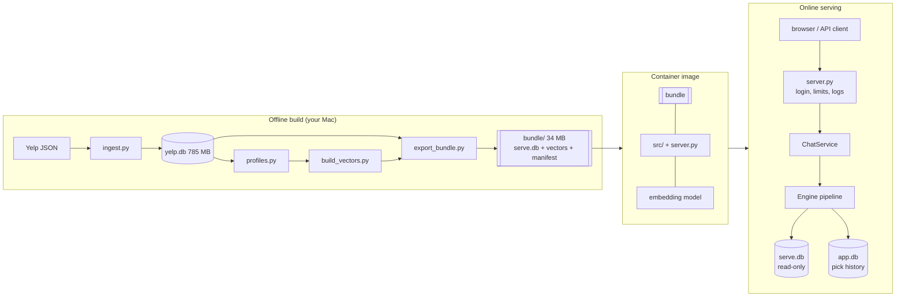

# Production guide

How the city guide goes from "runs on my laptop" to "runs as a service other
people can use", what was changed to get there, and what is still to do.

## What production means here

| Need | On a laptop | In production |
|---|---|---|
| Data | 785 MB `yelp.db`, rebuilt by hand | a 34 MB serving bundle with hashes, versioned with the code |
| Many users at once | one person, one thread | several requests at a time, on several threads |
| Configuration | edit code, `.env` | environment variables set by the host; secrets never in git |
| Identity | type any user id | a login decides who you are |
| Abuse and cost | none | input limits, rate limits, a fixed LLM backend |
| Knowing what happened | read the terminal | structured logs, a health check, request ids |
| Changing safely | run it and look | tests on every push; the same image in every environment |

## Architecture: offline build, online serving



The heavy, slow work (parsing 8 GB of JSON, embedding) happens once, offline.
The service only reads a small, fixed bundle, plus one small writable
database for users' history.

## What changed, and why

| Problem | Fix | Where |
|---|---|---|
| One SQLite connection was shared, but a web server answers on several threads, and SQLite refuses to share a connection across threads | one connection per thread, read-only for the Yelp data | `engine.py` (`Engine.con`), `db.py` |
| Settings were scattered and hard-coded | one module reads every setting from environment variables | `settings.py` |
| 785 MB of data, most of it unused when serving | a bundle with only one city's open businesses, plus SHA-256 hashes | `export_bundle.py` |
| The first user waited for the model and vectors to load | load them at startup | `Engine.warm()` |
| No limits: huge messages, unlimited requests | 500-character limit, 20 messages a minute per user or IP | `service.py` |
| Anyone could type any user id and read their history | optional login; the login name becomes the user id | `server.py`, `service.basic_auth_user` |
| Visitors could switch to the paid Claude backend | the backend is set once at startup (`CITY_GUIDE_LLM`, or `--llm` for `app.py`); the page has no picker | `settings.py`, `app.py` |
| The dev page and the production page took different code paths | both are `app.build_demo(service)`: page -> `ChatService.chat` -> `Engine.handle` | `app.py`, `server.py` |
| `print` output only | one JSON log line per request: mode, timings, who parsed and wrote it; message length, never message text | `service.log_event` |
| No way for the host to check the app | `GET /health` checks the data is readable and reports what's served | `server.py` |
| No programmatic access | `POST /api/chat`, documented at `/api/docs` | `server.py` |
| The local model isn't safe to share across threads | one generation at a time | `llm.py` |
| Nothing guarded against regressions | 14 standard-library tests on a fixture city, run by GitHub Actions on every push | `tests/`, `.github/workflows/tests.yml` |
| "Works on my machine" | a container image: pinned packages, CPU-only torch, model baked in, non-root user | `Dockerfile`, `requirements-serve.txt` |

## Run it like production, on your Mac

Inside `.venv`:

```
python src/export_bundle.py --city Philadelphia          # creates bundle/

CITY_GUIDE_DB=bundle/serve.db \
CITY_GUIDE_VECTORS=bundle/vectors \
CITY_GUIDE_USERS="zara:choose-a-password" \
uvicorn server:app --port 7860
```

Then:

```
curl http://127.0.0.1:7860/health
curl -u zara:choose-a-password -X POST http://127.0.0.1:7860/api/chat \
     -H "Content-Type: application/json" \
     -d '{"message": "I live in Philly, new restaurant every week"}'
open http://127.0.0.1:7860            # the web UI; the browser asks for the login
```

Each request prints one JSON line in the terminal: that's the production log.

## Run it as a container

Needs [Docker Desktop](https://www.docker.com/products/docker-desktop/).

```
python src/export_bundle.py --city Philadelphia
docker build -t city-guide .
docker run -p 7860:7860 -v city-guide-state:/app/state \
  -e CITY_GUIDE_USERS="zara:choose-a-password" city-guide
```

`-v city-guide-state:/app/state` keeps users' history when the container is replaced.

## Where to host it

| Option | What it is | Good for | Watch out for |
|---|---|---|---|
| Hugging Face Spaces (Docker) | runs this Dockerfile from a Space repo; secrets as env vars | free, visible portfolio link, fits the HF part of the project | the free tier sleeps when idle; disk resets on restart unless you add storage |
| Google Cloud Run | runs a container image, scales to zero | real-world production skills, pay per use | needs a Google Cloud account and billing; disk is temporary |
| Fly.io, Render | container hosting with attachable disks | simple, persistent volume for `app.db` | small monthly cost for always-on |

Suggested path: Hugging Face Spaces first (free, shareable), keep the image
portable so moving to Cloud Run later only changes where it runs. Keep the
login on until you have decided who should be able to use it.

## Configuration

| Variable | Default | Meaning |
|---|---|---|
| `CITY_GUIDE_DATA` | `data` | folder for the Yelp files and everything built from them |
| `CITY_GUIDE_DB` | `data/yelp.db` | Yelp data (the bundle's `serve.db` in production) |
| `CITY_GUIDE_VECTORS` | `data/vectors` | vector databases |
| `CITY_GUIDE_APP_DB` | `data/app.db` | users' pick history (must be on persistent storage) |
| `CITY_GUIDE_CITY` | `Philadelphia` | default city |
| `CITY_GUIDE_LLM` | `rules` | `rules`, `hf` or `claude` |
| `CITY_GUIDE_HF_MODEL` | `Qwen/Qwen2.5-0.5B-Instruct` | model for `hf` |
| `CITY_GUIDE_CLAUDE_MODEL` | `claude-haiku-5-5` | model for `claude` |
| `ANTHROPIC_API_KEY` | | only for `claude`; set as a host secret |
| `CITY_GUIDE_USERS` | empty (no login) | `name:password,name2:password2` |
| `CITY_GUIDE_MAX_MESSAGE_CHARS` | `500` | longest accepted message |
| `CITY_GUIDE_RATE_LIMIT_PER_MINUTE` | `20` | messages per user (or IP) per minute |
| `CITY_GUIDE_DEBUG_TRACE` | `0` | `1` returns the full pipeline trace |

## Runbook

- **Is it up?** `GET /health` returns `{"status": "ok", ...}` with the backend, search method and city.
- **What happened to a request?** Every reply has a `request_id`; search the logs for it.
- **Update the data:** rebuild offline, run `export_bundle.py`, build a new image, deploy it.
  The bundle's `manifest.json` records counts, hashes and the code version.
- **Roll back:** redeploy the previous image tag; data and code roll back together.
- **Rotate a password or API key:** change the host's secret and restart. Nothing is in git.

## Not done yet

1. **Shared history store.** `app.db` is a file on one machine. With two copies of the
   app running, or a host whose disk resets, history is lost or split. Next step:
   the same `history.py` interface backed by Postgres (for example a free managed tier).
2. **Continuous deployment.** Build and publish the image from GitHub Actions on each
   release, with the bundle pulled from private storage (it isn't in git).
3. **An evaluation gate.** Run `evals/retrieval_eval.py` in CI and block a deploy if
   search quality drops (needs the hand labels first).
4. **Monitoring and alerts.** Ship the JSON logs to a log service; alert on error rate
   and slow requests (p95 of `total_ms`).
5. **Smaller image.** Run the embedding model with ONNX Runtime instead of PyTorch.
6. **Real accounts.** Replace the shared-password login with sign-in (for example
   Hugging Face OAuth on Spaces), and limit Claude spend per user.
